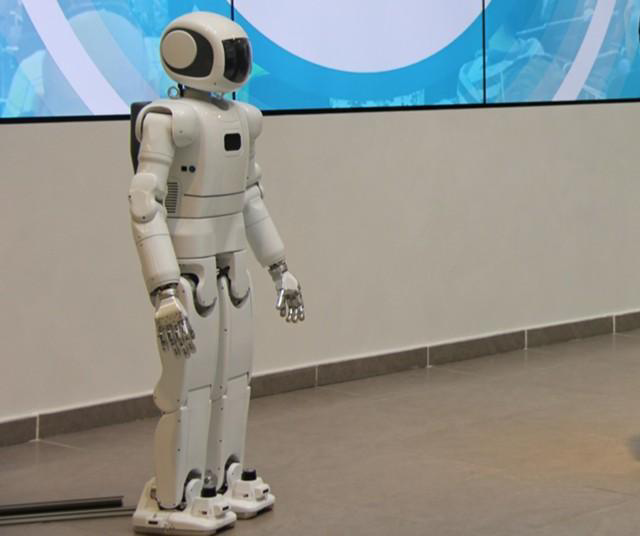

# AR-601M Arm Kinematics

Python kinematics for a six-joint AR-601M arm: forward kinematics, analytical and numerical inverse kinematics, a spatial Jacobian, and singularity and workspace maps. The model covers both mirrored arms.

This is a course project for [Introduction to Robotics at MIPT](https://github.com/Lupasic/In2Ro_MIPT_2026). It uses the published arm geometry and adapts the course's [starter interface](https://github.com/Lupasic/In2Ro_MIPT_2026/tree/main/slides/homework/W01/input_data).



Photo from the [course assignment](https://github.com/Lupasic/In2Ro_MIPT_2026/blob/main/slides/homework/W01/resources/ar601m_robot.png).

## Results

- Analytical IK enumerates isolated real branches before joint-limit filtering and represents continuous singular families separately. One reachable target has two feasible branches for each arm.
- Numerical IK reaches both branches from different initial configurations; unsuccessful runs and their residuals are retained in the report.
- Two Jacobian derivations agree with a finite-difference check. A 15,625-configuration joint-space scan and a fixed-orientation Cartesian slice show singular regions and feasible IK counts.

The [technical report](REPORT.md) gives the derivations, parameters, numerical results, tolerances, and figures for Tasks 1–6. Separate PDFs cover [Task 3 IK](TASK3_DERIVATION.pdf) ([source](TASK3_DERIVATION.tex)) and [Task 5 Jacobians](TASK5_JACOBIAN_DERIVATIONS.pdf) ([source](TASK5_JACOBIAN_DERIVATIONS.tex)).

## Reproduce

Install [Pixi](https://pixi.sh), then run from the repository root:

```bash
pixi run check
```

This runs the automated tests and regenerates `REPORT.md` and all figures from a clean checkout.

## Explore poses

```bash
pixi run python src/visualize.py --q 20 -35 10 25 40 -15
pixi run python src/visualize.py --fk-target 10 5 -30 -40 -30 20 --side left
```

`--q` prints the base-to-tool transform and saves an arm drawing. `--fk-target` prints and draws every feasible IK branch for the pose generated from those six angles. Use `--pose x y z roll pitch yaw` for a target pose, or add `--show` to open the drawings. CLI angles are degrees; Python API angles are radians; lengths are metres. Orientation uses ZYX roll–pitch–yaw. Download the [rotatable frame diagram](task1_interactive_3d.html) to open it locally in a browser.

The models are in `robot_model.json` and `robot_model_left.json`; the required `FK`, `IK`, and `DifferentialKinematics` entry points are in `src/kinematics.py`.
