# AR-601M Arm Kinematics — Technical Report

MIPT Introduction to Robotics course project. [Assignment and mechanism data](https://github.com/Lupasic/In2Ro_MIPT_2026/blob/main/slides/homework/W01/resources/hw01_handout.pdf). All results below are regenerated by `pixi run check`; automated tests: 10 passed, 2 subtests passed.

## Task 1 — kinematic model

Inputs: `robot_model.json` (right, b=+1) and `robot_model_left.json` (left, b=−1). Right-handed frames, column vectors, local-frame translations; angles in code are radians. The chosen factor order matches the [course starter](https://github.com/Lupasic/In2Ro_MIPT_2026/tree/main/slides/homework/W01/input_data).

`T_base→tool = Rz(q₁) Dz(l₁) Rz(b·10°) Ry(q₂) Dy(−b·l₂) Rx(q₃) Dz(−l₃) Rz(q₄) Ry(q₅) Rx(q₆) Dx(l₄)`

| joint | type | local axis | closed limit |
|---|---|---|---|
| q1 | revolute | z | -90°…90° |
| q2 | revolute | y | -105°…105° |
| q3 | revolute | x | -45°…45° |
| q4 | revolute | z | -90°…90° |
| q5 | revolute | y | -90°…90° |
| q6 | revolute | x | -90°…90° |

| offset | value | right direction | left direction |
|---|---:|---|---|
| l₁ | 0.40 m | +z | +z |
| l₂ | 0.18 m | −y | +y |
| l₃ | 0.30 m | −z | −z |
| l₄ | 0.12 m | +x | +x |

Fixed rotation: +10° right, −10° left, about local z between q₁ and q₂. Frames in the factor chain: {base},{1} at B; {2} at C; {3} at S; {4},{5},{6} at W; {tool} at T. Axes q₁ and q₂ lie on their respective axial offset lines, so their origin can slide along l₁ or l₂ without changing FK; the factor order above fixes their displayed origins.

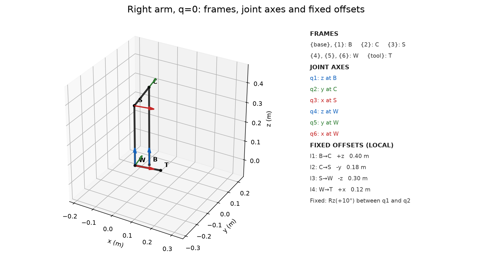

[Rotatable 3D diagram](task1_interactive_3d.html). Model-file contents: the table and chain above reproduce every geometric parameter; both JSON files additionally store the explicit ordered transform list. `tests/test_task1_model.py` loads both files and checks six revolute joints, their order, axes, limits and mirrored geometry; exact parameter check, numeric tolerance 0.

## Task 2 — forward kinematics

Source: `src/task2_fk.py`; test: `tests/test_task2_fk.py`.
Model: `robot_model.json`; arm: right (`b = 1`).
Column vectors; ordered local offsets in metres; q in radians in FK.
ZYX convention: R = Rz(yaw) Ry(pitch) Rx(roll).
Checks on unrounded T: Frobenius norm ||RᵀR − I|| and |det(R) − 1|; tolerance for each = 1e-12.

### zero

q (degrees) = [0, 0, 0, 0, 0, 0]
q (radians) = [0.000000000, 0.000000000, 0.000000000, 0.000000000, 0.000000000, 0.000000000]
T =
```text
[[ 0.984807753 -0.173648178  0.000000000  0.149433602]
 [ 0.173648178  0.984807753  0.000000000 -0.156427614]
 [ 0.000000000  0.000000000  1.000000000  0.100000000]
 [ 0.000000000  0.000000000  0.000000000  1.000000000]]
```
||RᵀR − I||_F = 1.582e-16; |det(R) − 1| = 1.110e-16; check = PASS.
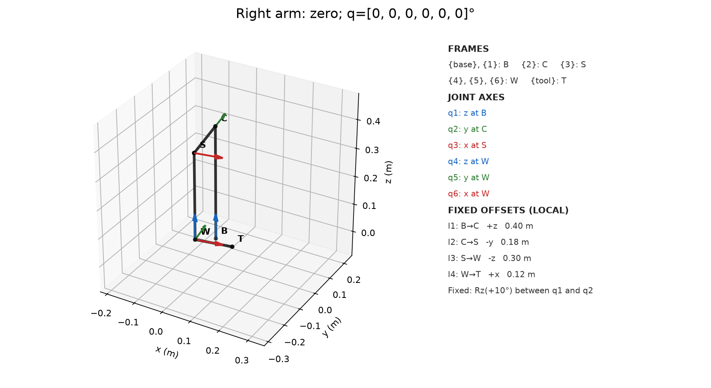

### at_limit

q (degrees) = [90, 0, 0, 0, 0, 0]
q1 is at its upper limit; all limits are closed intervals.
q (radians) = [1.570796327, 0.000000000, 0.000000000, 0.000000000, 0.000000000, 0.000000000]
T =
```text
[[-0.173648178 -0.984807753  0.000000000  0.156427614]
 [ 0.984807753 -0.173648178  0.000000000  0.149433602]
 [ 0.000000000  0.000000000  1.000000000  0.100000000]
 [ 0.000000000  0.000000000  0.000000000  1.000000000]]
```
||RᵀR − I||_F = 1.581e-16; |det(R) − 1| = 1.110e-16; check = PASS.
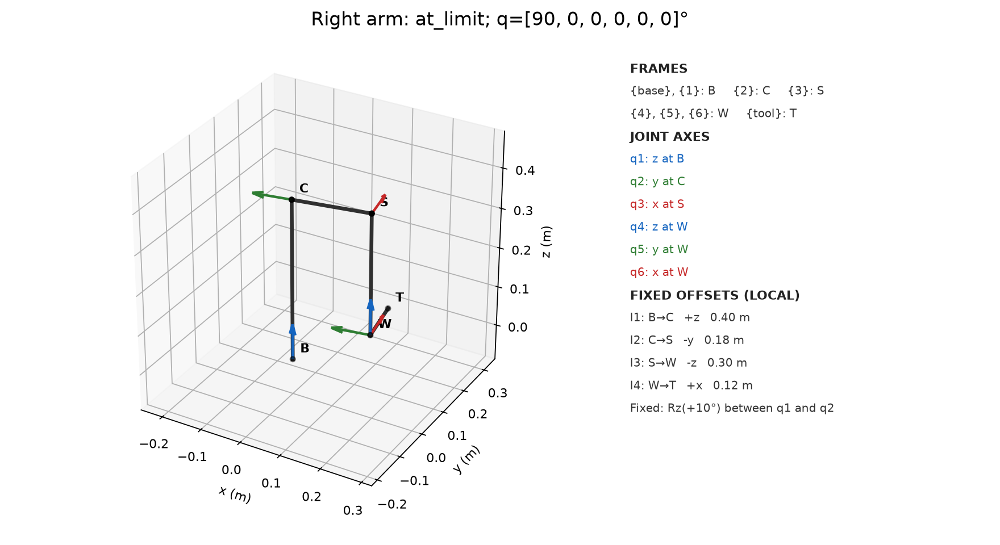

### generic

q (degrees) = [20, -35, 10, 25, 40, -15]
All six angles are strictly inside their limits.
q (radians) = [0.349065850, -0.610865238, 0.174532925, 0.436332313, 0.698131701, -0.261799388]
T =
```text
[[ 0.563815823 -0.782670080 -0.263702984  0.278366260]
 [ 0.822554133  0.503425226  0.264514159  0.072666421]
 [-0.074272584 -0.366047248  0.927627617  0.149075105]
 [ 0.000000000  0.000000000  0.000000000  1.000000000]]
```
||RᵀR − I||_F = 4.172e-16; |det(R) − 1| = 2.220e-16; check = PASS.
ZYX roll–pitch–yaw (degrees) = [-21.534480182, 4.259427843, 55.571496700].
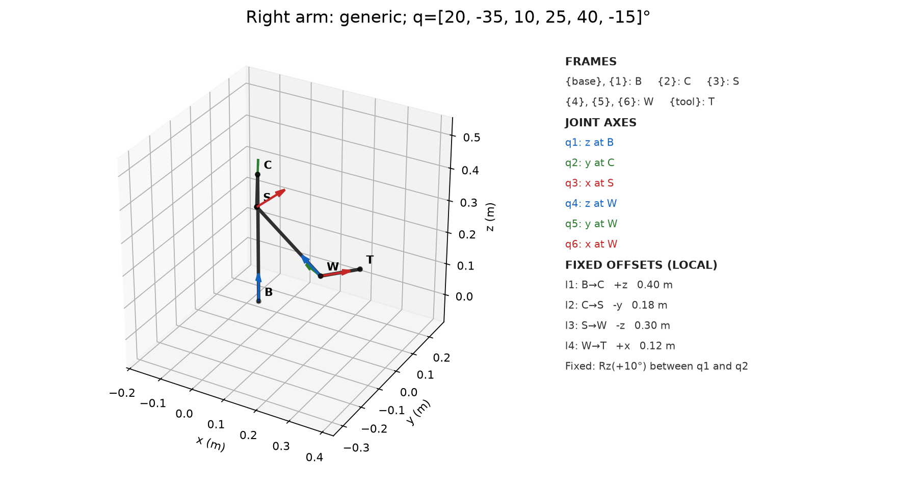

### Visualizer (Tasks 2–3)

Run from the repository root. Positions are in metres; CLI angles are in degrees.

```bash
pixi run python src/visualize.py --q 20 -35 10 25 40 -15 --show
pixi run python src/visualize.py --fk-target 10 5 -30 -40 -30 20 --show
pixi run python src/visualize.py --pose 0.278366260 0.072666421 0.149075105 -21.534480182 4.259427843 55.571496700 --show
```

`--q` takes six joint angles and shows the arm and FK matrix T.
`--fk-target` takes six joint angles, uses their FK pose as the IK target, and shows every feasible branch.
`--pose` takes x y z roll pitch yaw, with R = Rz(yaw) Ry(pitch) Rx(roll), and solves IK for that target.
Add `--side left` for the left arm. Without `--show`, drawings are saved as PNG files.
Continuous families are printed separately, with one feasible example drawn when available.

## Task 3 — analytical IK

Standalone derivation: [PDF](TASK3_DERIVATION.pdf) · [LaTeX source](TASK3_DERIVATION.tex).

Both arms use the same limits and lengths; b=+1 (right), b=−1 (left). For target
\(T=\begin{bmatrix}R&p\\0&1\end{bmatrix}\), the wrist centre is \(W=p-l_4Re_x\). Put
\(r=W-l_1e_z=(x,y,z)\), \(\rho=\sqrt{x^2+y^2}\),
\(\phi=\operatorname{atan2}(y,x)\), and \(\theta=q_1+b10^\circ\).
Because \(R_y(q_2)e_y=e_y\), the shoulder offset is
\(S-l_1e_z=R_z(\theta)(-bl_2e_y)\). From \(\|W-S\|=l_3\):

\[\rho\sin(\theta-\phi)=bK,\quad K=(\|r\|^2+l_2^2-l_3^2)/(2l_2).\]

For \(\rho>0\) and \(|K|\le\rho\), the two q₁ candidates are
\(\theta=\phi+\arcsin(bK/\rho)\) and
\(\theta=\phi+\pi-\arcsin(bK/\rho)\), then \(q_1=\theta-b10^\circ\).
For each, transform the wrist displacement to the shoulder axes:

\[u=R_z(-\theta)r+bl_2e_y
=l_3(-\sin q_2\cos q_3,\sin q_3,-\cos q_2\cos q_3).\]

For \(\sigma=\pm1\), take
\(q_3=\operatorname{atan2}(u_y,\sigma\sqrt{l_3^2-u_y^2})\) and
\(q_2=\operatorname{atan2}(-\sigma u_x,-\sigma u_z)\).
Finally \(Q=(R_z(\theta)R_y(q_2)R_x(q_3))^TR=R_z(q_4)R_y(q_5)R_x(q_6)\).
With \(h=\sqrt{Q_{11}^2+Q_{21}^2}>0\), each \(\tau=\pm1\) yields
\(q_5=\operatorname{atan2}(-Q_{31},\tau h)\),
\(q_4=\operatorname{atan2}(\tau Q_{21},\tau Q_{11})\),
\(q_6=\operatorname{atan2}(\tau Q_{32},\tau Q_{33})\).

All real branches are listed before applying the closed limits, then feasible
ones are listed after. A duplicate has maximum wrapped joint-angle difference
<1e−8 rad. Each branch is checked against FK with pose Frobenius tolerance
1e−8. If \(|K|>\rho\), the target is unreachable. If \(\rho=0,K=0\),
q₁ is free; if \(|u_y|=l₃\), q₂ is free (but q₃=±90° violates the limits).
If \(h=0\), q₅=\(s90^\circ\), and the continuous wrist family is
\(q_4-sq_6=\delta\pmod{2\pi}\), where
\(s=-Q_{31}\), \(\delta=\operatorname{atan2}(sQ_{23},Q_{22})\).
`solve_ik` reports such families parametrically; `IK` signals feasible
continuous families with `InfiniteSolutions`. Sources:
`src/task3_ik.py`, `tests/test_task3_ik.py`.

Source: `src/task3_ik.py`; targets use Task 2's three q values plus the two-branch example.
Models: `robot_model.json` (right), `robot_model_left.json` (left).
Duplicate rule: max_i |wrap(q_i−q'_i)| < 1e-08 rad. Pose residual tolerance: 1e-08.
Residuals: e_p = ||p_target−p_FK||₂ (m), e_R = ||R_target−R_FK||_F, e_T = ||T_target−T_FK||_F.

Residuals use unrounded matrices; displayed numbers are rounded.

### right arm, b = 1

#### zero: target from q = [0, 0, 0, 0, 0, 0]°

Target T =
```text
[[ 0.984807753 -0.173648178  0.000000000  0.149433602]
 [ 0.173648178  0.984807753  0.000000000 -0.156427614]
 [ 0.000000000  0.000000000  1.000000000  0.100000000]
 [ 0.000000000  0.000000000  0.000000000  1.000000000]]
```
Status: ok; real branches: 4; feasible branches: 1.
| # | q1, q2, q3, q4, q5, q6 (degrees) | feasible | e_p (m) | e_R | e_T |
|---:|---|:---:|---:|---:|---:|
| 1 | 0.000000, 0.000000, 0.000000, 0.000000, 0.000000, 0.000000 | yes | 0.00e+00 | 0.00e+00 | 0.00e+00 |
| 2 | 0.000000, 0.000000, 0.000000, -180.000000, -180.000000, -180.000000 | no | 3.10e-17 | 2.91e-16 | 2.93e-16 |
| 3 | 0.000000, -180.000000, -180.000000, -180.000000, 0.000000, 0.000000 | no | 6.36e-17 | 2.91e-16 | 2.98e-16 |
| 4 | 0.000000, -180.000000, -180.000000, 0.000000, -180.000000, -180.000000 | no | 7.85e-17 | 6.16e-33 | 7.85e-17 |

#### at_limit: target from q = [90, 0, 0, 0, 0, 0]°

Target T =
```text
[[-0.173648178 -0.984807753  0.000000000  0.156427614]
 [ 0.984807753 -0.173648178  0.000000000  0.149433602]
 [ 0.000000000  0.000000000  1.000000000  0.100000000]
 [ 0.000000000  0.000000000  0.000000000  1.000000000]]
```
Status: ok; real branches: 4; feasible branches: 1.
| # | q1, q2, q3, q4, q5, q6 (degrees) | feasible | e_p (m) | e_R | e_T |
|---:|---|:---:|---:|---:|---:|
| 1 | 90.000000, 0.000000, 0.000000, 0.000000, 0.000000, 0.000000 | yes | 0.00e+00 | 0.00e+00 | 0.00e+00 |
| 2 | 90.000000, 0.000000, 0.000000, -180.000000, -180.000000, -180.000000 | no | 1.39e-17 | 2.91e-16 | 2.91e-16 |
| 3 | 90.000000, -180.000000, -180.000000, -180.000000, 0.000000, 0.000000 | no | 6.36e-17 | 2.91e-16 | 2.98e-16 |
| 4 | 90.000000, -180.000000, -180.000000, 0.000000, -180.000000, -180.000000 | no | 6.21e-17 | 2.47e-32 | 6.21e-17 |

#### generic: target from q = [20, -35, 10, 25, 40, -15]°

Target T =
```text
[[ 0.563815823 -0.782670080 -0.263702984  0.278366260]
 [ 0.822554133  0.503425226  0.264514159  0.072666421]
 [-0.074272584 -0.366047248  0.927627617  0.149075105]
 [ 0.000000000  0.000000000  0.000000000  1.000000000]]
```
Status: ok; real branches: 8; feasible branches: 1.
| # | q1, q2, q3, q4, q5, q6 (degrees) | feasible | e_p (m) | e_R | e_T |
|---:|---|:---:|---:|---:|---:|
| 1 | 20.000000, -35.000000, 10.000000, 25.000000, 40.000000, -15.000000 | yes | 7.85e-17 | 1.10e-15 | 1.10e-15 |
| 2 | 20.000000, -35.000000, 10.000000, -155.000000, 140.000000, 165.000000 | no | 1.04e-16 | 1.21e-15 | 1.21e-15 |
| 3 | 20.000000, 145.000000, 170.000000, -155.000000, 40.000000, -15.000000 | no | 2.24e-16 | 5.18e-16 | 5.64e-16 |
| 4 | 20.000000, 145.000000, 170.000000, 25.000000, 140.000000, 165.000000 | no | 2.08e-16 | 6.26e-16 | 6.60e-16 |
| 5 | 125.909818, 35.000000, 10.000000, -79.419775, -11.849120, 11.094474 | no | 6.21e-17 | 5.51e-16 | 5.55e-16 |
| 6 | 125.909818, 35.000000, 10.000000, 100.580225, -168.150880, -168.905526 | no | 5.72e-17 | 1.11e-15 | 1.11e-15 |
| 7 | 125.909818, -145.000000, 170.000000, 100.580225, -11.849120, 11.094474 | no | 1.94e-16 | 9.82e-16 | 1.00e-15 |
| 8 | 125.909818, -145.000000, 170.000000, -79.419775, -168.150880, -168.905526 | no | 1.72e-16 | 5.68e-16 | 5.93e-16 |

#### two_branches: target from q = [10, 5, -30, -40, -30, 20]°

Target T =
```text
[[ 0.758671758  0.133403897 -0.637668067  0.182629116]
 [ 0.029148166  0.970878458  0.237792776 -0.314345395]
 [ 0.650820673 -0.198993518  0.732689588  0.219279506]
 [ 0.000000000  0.000000000  0.000000000  1.000000000]]
```
Status: ok; real branches: 8; feasible branches: 2.
| # | q1, q2, q3, q4, q5, q6 (degrees) | feasible | e_p (m) | e_R | e_T |
|---:|---|:---:|---:|---:|---:|
| 1 | 2.149336, -5.000000, -30.000000, -26.812618, -26.068834, 17.063812 | yes | 0.00e+00 | 5.37e-16 | 5.37e-16 |
| 2 | 2.149336, -5.000000, -30.000000, 153.187382, -153.931166, -162.936188 | no | 9.61e-17 | 7.91e-16 | 7.97e-16 |
| 3 | 2.149336, 175.000000, -150.000000, 153.187382, -26.068834, 17.063812 | no | 7.85e-17 | 1.03e-15 | 1.03e-15 |
| 4 | 2.149336, 175.000000, -150.000000, -26.812618, -153.931166, -162.936188 | no | 5.55e-17 | 3.33e-16 | 3.37e-16 |
| 5 | 10.000000, 5.000000, -30.000000, -40.000000, -30.000000, 20.000000 | yes | 7.85e-17 | 6.85e-16 | 6.89e-16 |
| 6 | 10.000000, 5.000000, -30.000000, 140.000000, -150.000000, -160.000000 | no | 2.78e-17 | 3.46e-16 | 3.47e-16 |
| 7 | 10.000000, -175.000000, -150.000000, 140.000000, -30.000000, 20.000000 | no | 8.33e-17 | 7.13e-16 | 7.18e-16 |
| 8 | 10.000000, -175.000000, -150.000000, -40.000000, -150.000000, -160.000000 | no | 5.55e-17 | 4.45e-16 | 4.48e-16 |

#### unreachable target: p = (2, 0, 0) m, R = I

Status: unreachable; branches: 0.

#### wrist singularity: q5 = +90°

Status: continuous; 2 real families:
1. (q1,q2,q3,q5) = [0.0, 0.0, 0.0, 90.0]°; q4 = 0.000000° + sin(q5)·q6; feasible q6 intervals = [[-90.0, 90.0]]°; sample q6=0 residual = 6.85e-18.
2. (q1,q2,q3,q5) = [0.0, -180.0, 180.0, 90.0]°; q4 = -180.000000° + sin(q5)·q6; feasible q6 intervals = []°; sample q6=0 residual = 2.97e-16.

#### axial wrist-centre degeneracy: W lies on the base z axis

Status: continuous; family: q1 free, joint interval [-90°,90°]. At q1=0: 1 feasible branch(es), sample residual = 1.62e-16.

#### arm degeneracy before filtering: q3 = +90°

Status: continuous; 1 real family/families: q2 free; feasible branches: 0 because |q3| > 45°.

### left arm, b = -1

#### zero: target from q = [0, 0, 0, 0, 0, 0]°

Target T =
```text
[[ 0.984807753  0.173648178  0.000000000  0.149433602]
 [-0.173648178  0.984807753  0.000000000  0.156427614]
 [ 0.000000000  0.000000000  1.000000000  0.100000000]
 [ 0.000000000  0.000000000  0.000000000  1.000000000]]
```
Status: ok; real branches: 4; feasible branches: 1.
| # | q1, q2, q3, q4, q5, q6 (degrees) | feasible | e_p (m) | e_R | e_T |
|---:|---|:---:|---:|---:|---:|
| 1 | 0.000000, 0.000000, 0.000000, 0.000000, 0.000000, 0.000000 | yes | 0.00e+00 | 0.00e+00 | 0.00e+00 |
| 2 | 0.000000, 0.000000, 0.000000, -180.000000, -180.000000, -180.000000 | no | 3.10e-17 | 2.91e-16 | 2.93e-16 |
| 3 | 0.000000, -180.000000, -180.000000, -180.000000, 0.000000, 0.000000 | no | 6.36e-17 | 2.91e-16 | 2.98e-16 |
| 4 | 0.000000, -180.000000, -180.000000, 0.000000, -180.000000, -180.000000 | no | 6.21e-17 | 6.16e-33 | 6.21e-17 |

#### at_limit: target from q = [90, 0, 0, 0, 0, 0]°

Target T =
```text
[[ 0.173648178 -0.984807753  0.000000000 -0.156427614]
 [ 0.984807753  0.173648178  0.000000000  0.149433602]
 [ 0.000000000  0.000000000  1.000000000  0.100000000]
 [ 0.000000000  0.000000000  0.000000000  1.000000000]]
```
Status: ok; real branches: 4; feasible branches: 1.
| # | q1, q2, q3, q4, q5, q6 (degrees) | feasible | e_p (m) | e_R | e_T |
|---:|---|:---:|---:|---:|---:|
| 1 | 90.000000, 0.000000, 0.000000, 0.000000, 0.000000, 0.000000 | yes | 0.00e+00 | 0.00e+00 | 0.00e+00 |
| 2 | 90.000000, 0.000000, 0.000000, -180.000000, -180.000000, -180.000000 | no | 1.39e-17 | 2.91e-16 | 2.91e-16 |
| 3 | 90.000000, -180.000000, -180.000000, -180.000000, 0.000000, 0.000000 | no | 6.36e-17 | 2.91e-16 | 2.98e-16 |
| 4 | 90.000000, -180.000000, -180.000000, 0.000000, -180.000000, -180.000000 | no | 6.21e-17 | 0.00e+00 | 6.21e-17 |

#### generic: target from q = [20, -35, 10, 25, 40, -15]°

Target T =
```text
[[ 0.811143651 -0.563287731 -0.157330578  0.223918756]
 [ 0.580111680  0.740753903  0.338753736  0.327608023]
 [-0.074272584 -0.366047248  0.927627617  0.149075105]
 [ 0.000000000  0.000000000  0.000000000  1.000000000]]
```
Status: ok; real branches: 8; feasible branches: 1.
| # | q1, q2, q3, q4, q5, q6 (degrees) | feasible | e_p (m) | e_R | e_T |
|---:|---|:---:|---:|---:|---:|
| 1 | 20.000000, -35.000000, 10.000000, 25.000000, 40.000000, -15.000000 | yes | 2.78e-17 | 5.37e-16 | 5.38e-16 |
| 2 | 20.000000, -35.000000, 10.000000, -155.000000, 140.000000, 165.000000 | no | 2.78e-17 | 2.14e-16 | 2.15e-16 |
| 3 | 20.000000, 145.000000, 170.000000, -155.000000, 40.000000, -15.000000 | no | 1.62e-16 | 7.87e-16 | 8.03e-16 |
| 4 | 20.000000, 145.000000, 170.000000, 25.000000, 140.000000, 165.000000 | no | 1.62e-16 | 6.60e-16 | 6.80e-16 |
| 5 | -52.268488, 35.000000, 10.000000, 94.149140, 17.957083, -55.821391 | no | 8.33e-17 | 7.99e-16 | 8.03e-16 |
| 6 | -52.268488, 35.000000, 10.000000, -85.850860, 162.042917, 124.178609 | no | 1.14e-16 | 8.61e-16 | 8.68e-16 |
| 7 | -52.268488, -145.000000, 170.000000, -85.850860, 17.957083, -55.821391 | no | 2.39e-16 | 5.21e-16 | 5.74e-16 |
| 8 | -52.268488, -145.000000, 170.000000, 94.149140, 162.042917, 124.178609 | no | 2.68e-16 | 9.44e-16 | 9.81e-16 |

#### two_branches: target from q = [10, 5, -30, -40, -30, 20]°

Target T =
```text
[[ 0.722887513  0.457418647 -0.517882058  0.064102775]
 [-0.232090707  0.866700503  0.441547440  0.002149115]
 [ 0.650820673 -0.198993518  0.732689588  0.219279506]
 [ 0.000000000  0.000000000  0.000000000  1.000000000]]
```
Status: ok; real branches: 8; feasible branches: 2.
| # | q1, q2, q3, q4, q5, q6 (degrees) | feasible | e_p (m) | e_R | e_T |
|---:|---|:---:|---:|---:|---:|
| 1 | 84.090344, -5.000000, -30.000000, -88.147411, -10.600701, -20.561091 | yes | 4.62e-17 | 3.69e-16 | 3.72e-16 |
| 2 | 84.090344, -5.000000, -30.000000, 91.852589, -169.399299, 159.438909 | no | 4.72e-17 | 1.30e-15 | 1.31e-15 |
| 3 | 84.090344, 175.000000, -150.000000, 91.852589, -10.600701, -20.561091 | no | 7.38e-17 | 1.00e-15 | 1.01e-15 |
| 4 | 84.090344, 175.000000, -150.000000, -88.147411, -169.399299, 159.438909 | no | 5.65e-17 | 1.45e-15 | 1.45e-15 |
| 5 | 10.000000, 5.000000, -30.000000, -40.000000, -30.000000, 20.000000 | yes | 5.30e-17 | 4.88e-16 | 4.91e-16 |
| 6 | 10.000000, 5.000000, -30.000000, 140.000000, -150.000000, -160.000000 | no | 3.94e-17 | 4.35e-16 | 4.37e-16 |
| 7 | 10.000000, -175.000000, -150.000000, 140.000000, -30.000000, 20.000000 | no | 5.72e-17 | 3.34e-16 | 3.39e-16 |
| 8 | 10.000000, -175.000000, -150.000000, -40.000000, -150.000000, -160.000000 | no | 4.22e-17 | 6.63e-16 | 6.64e-16 |

#### unreachable target: p = (2, 0, 0) m, R = I

Status: unreachable; branches: 0.

#### wrist singularity: q5 = +90°

Status: continuous; 2 real families:
1. (q1,q2,q3,q5) = [0.0, 0.0, 0.0, 90.0]°; q4 = -0.000000° + sin(q5)·q6; feasible q6 intervals = [[-90.0, 90.0]]°; sample q6=0 residual = 6.85e-18.
2. (q1,q2,q3,q5) = [0.0, -180.0, 180.0, 90.0]°; q4 = 180.000000° + sin(q5)·q6; feasible q6 intervals = []°; sample q6=0 residual = 3.05e-16.

#### axial wrist-centre degeneracy: W lies on the base z axis

Status: continuous; family: q1 free, joint interval [-90°,90°]. At q1=0: 1 feasible branch(es), sample residual = 1.62e-16.

#### arm degeneracy before filtering: q3 = +90°

Status: continuous; 1 real family/families: q2 free; feasible branches: 0 because |q3| > 45°.


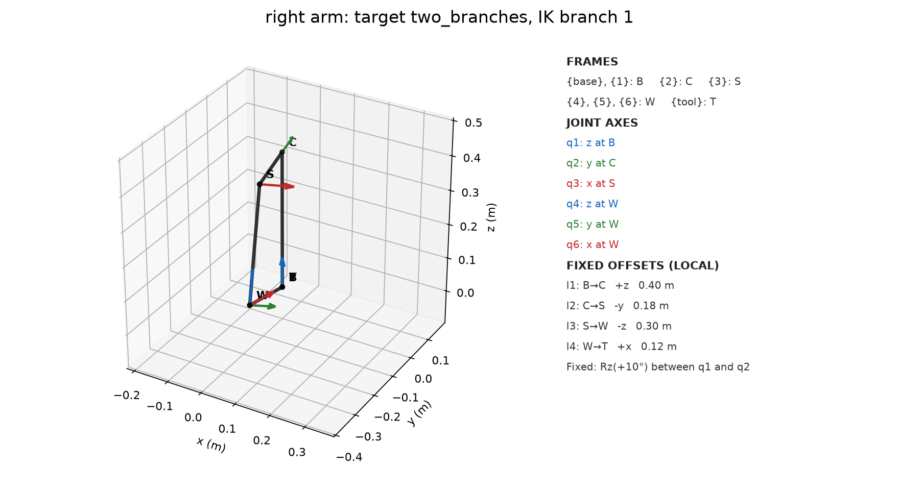

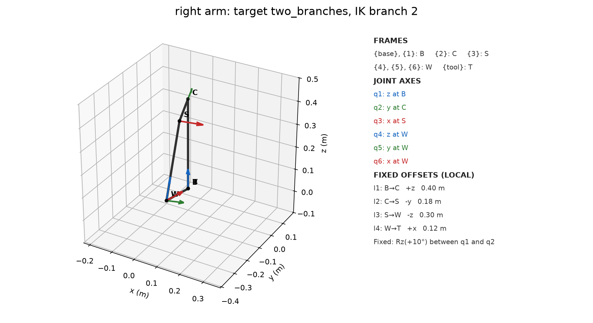

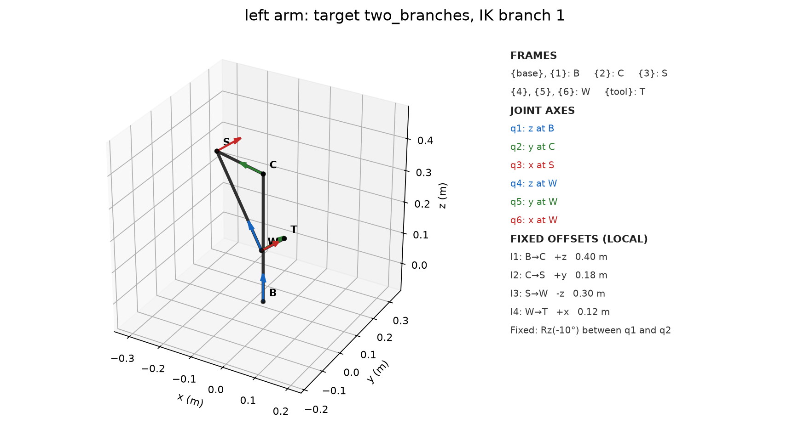

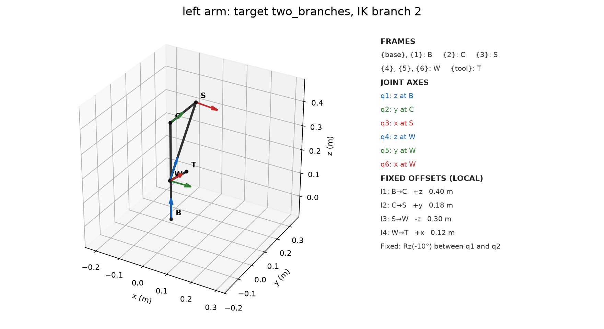

## Task 4 — numerical IK

Projected damped least squares with backtracking; pose error uses base-frame position and rotation vector log(R_target R_currentᵀ). Joint limits are closed. Convergence: both residual norms ≤ 1e−8; at most 120 iterations. Nearest branch is among feasible isolated branches from Task 3; a feasible continuous family is named instead. `max_iterations` means the tolerance was not met in 120 steps; `no_descent_step` means none of seven projected trial steps reduced the pose error. Source: `src/task4_numerical_ik.py`; test: `tests/test_tasks4_to_6.py`.

| arm | target | initial q (deg) | status | iterations | final q (deg) | position (m) | orientation (rad) | nearest branch / distance (rad) |
|---|---|---|---|---:|---|---:|---:|---|
| right | zero | [2.0, -2.0, 1.0, 2.0, -1.0, 1.0] | converged | 20 | [-0.0241, -0.0144, 0.0, 0.0241, 0.0144, 0.0] | 9.38e-09 | 1.14e-09 | 1 / 6.92e-04 |
| right | at_limit | [90.0, -2.0, 1.0, 2.0, -1.0, 1.0] | converged | 19 | [89.9753, -0.0148, 0.0, 0.0247, 0.0148, 0.0] | 9.90e-09 | 1.20e-09 | 1 / 7.11e-04 |
| right | generic | [22.0, -37.0, 11.0, 27.0, 39.0, -14.0] | converged | 3 | [20.0, -35.0, 10.0, 25.0, 40.0, -15.0] | 3.35e-11 | 8.44e-11 | 1 / 4.48e-10 |
| right | two_branches | [4.1493, -7.0, -29.0, -24.8126, -27.0688, 18.0638] | converged | 4 | [2.1493, -5.0, -30.0, -26.8126, -26.0688, 17.0638] | 1.18e-09 | 5.00e-09 | 1 / 1.23e-07 |
| right | two_branches | [12.0, 3.0, -29.0, -38.0, -31.0, 21.0] | converged | 5 | [10.0, 5.0, -30.0, -40.0, -30.0, 20.0] | 2.79e-11 | 3.07e-11 | 2 / 4.58e-09 |
| right | wrist_singular | [2.0, -2.0, 1.0, 2.0, 89.0, 1.0] | converged | 6 | [-0.0, -0.0, 0.0, 2.8092, 90.0, 2.8092] | 1.01e-10 | 8.44e-10 | family q6 |
| right | axial | [2.0, -2.0, 37.8699, 2.0, -1.0, 1.0] | converged | 3 | [-1.7437, 0.0, 36.8699, 1.3951, 1.0461, 0.0127] | 1.30e-11 | 5.60e-11 | family q1 |
| right | arm_degenerate | [2.0, -2.0, 45.0, 2.0, -1.0, 1.0] | no_descent_step | 1 | [2.0, -2.0, 45.0, 2.0, -1.0, 1.0] | 2.19e-01 | 7.71e-01 | none |
| right | unreachable p=(2,0,0) m | [0,0,0,0,0,0] | max_iterations | 120 | [52.5782, -0.0927, -34.8941, -50.6192, 12.6718, 10.9468] | 1.59e+00 | 3.70e-01 | none |
| left | zero | [2.0, -2.0, 1.0, 2.0, -1.0, 1.0] | converged | 20 | [0.0241, -0.0145, -0.0, -0.0241, 0.0145, -0.0] | 9.45e-09 | 1.14e-09 | 1 / 6.95e-04 |
| left | at_limit | [90.0, -2.0, 1.0, 2.0, -1.0, 1.0] | converged | 32 | [90.0, -0.0, -0.0, -0.0, 0.0, -0.0] | 1.85e-09 | 8.54e-09 | 1 / 1.12e-08 |
| left | generic | [22.0, -37.0, 11.0, 27.0, 39.0, -14.0] | converged | 3 | [20.0, -35.0, 10.0, 25.0, 40.0, -15.0] | 6.90e-11 | 1.61e-10 | 1 / 7.56e-10 |
| left | two_branches | [86.0903, -7.0, -29.0, -86.1474, -11.6007, -19.5611] | converged | 4 | [84.0903, -5.0, -30.0, -88.1474, -10.6007, -20.5611] | 2.15e-13 | 2.87e-14 | 1 / 2.20e-11 |
| left | two_branches | [12.0, 3.0, -29.0, -38.0, -31.0, 21.0] | converged | 4 | [10.0, 5.0, -30.0, -40.0, -30.0, 20.0] | 2.22e-12 | 6.29e-13 | 2 / 2.21e-10 |
| left | wrist_singular | [2.0, -2.0, 1.0, 2.0, 89.0, 1.0] | converged | 7 | [-0.0, 0.0, 0.0, 1.4633, 90.0, 1.4633] | 3.42e-10 | 1.83e-09 | family q6 |
| left | axial | [2.0, -2.0, -35.8699, 2.0, -1.0, 1.0] | converged | 3 | [4.8012, 0.0, -36.8699, -3.8442, 2.8785, -0.0966] | 2.95e-13 | 1.26e-12 | family q1 |
| left | arm_degenerate | [2.0, -2.0, 45.0, 2.0, -1.0, 1.0] | no_descent_step | 7 | [21.2272, -77.9665, 45.0, -77.3941, 12.6886, -0.6632] | 8.76e-02 | 2.49e-01 | none |
| left | unreachable p=(2,0,0) m | [0,0,0,0,0,0] | max_iterations | 120 | [-52.5782, -0.0927, 34.8941, 50.6192, 12.6718, -10.9468] | 1.59e+00 | 3.70e-01 | none |

## Task 5 — differential kinematics

Full derivations: [PDF](TASK5_JACOBIAN_DERIVATIONS.pdf) · [LaTeX source](TASK5_JACOBIAN_DERIVATIONS.tex).

Right arm, b=+1, same generic q as Task 2. Base-frame tool velocity [v;ω]=J(q)q̇, where v=ṗ (m/s) and ω is angular velocity (rad/s). First derivation: for each joint axis aᵢ through pᵢ, Jᵥᵢ=aᵢ×(p_tool−pᵢ), Jωᵢ=aᵢ. Independent product derivation: differentiate each joint factor in T=F₁…Fₙ, dT/dqᵢ=F₁…Fᵢ₋₁ GᵢFᵢ…Fₙ; extract vᵢ=dp/dqᵢ and ωᵢ=vee((dR/dqᵢ)Rᵀ). FK finite difference: dp/dqᵢ≈[p(q+h dᵢ)−p(q−h dᵢ)]/(2h), ωᵢ≈vee(skew(([R(q+h dᵢ)−R(q−h dᵢ)]/(2h))Rᵀ)), where dᵢ is the ith joint-space basis vector, skew(M)=(M−Mᵀ)/2, and h=10⁻⁶ rad. Pairwise Frobenius tolerance 10⁻⁸.

| case | q (degrees) | geometric vs product | geometric vs FD | product vs FD |
|---|---|---:|---:|---:|
| generic | [20, -35, 10, 25, 40, -15] | 7.444e-16 | 9.172e-11 | 9.172e-11 |
| near singular | [0, 0, 0, 0, 89.9, 0] | 2.494e-16 | 8.471e-11 | 8.471e-11 |

Geometric J at generic q (top rows m/rad; bottom rows dimensionless):
```text
[[-0.072666421 -0.217307334 -0.233864285 -0.075769695  0.006257712
   0.000000000]
 [ 0.278366260 -0.125462448  0.286050195  0.050993991 -0.015024603
  -0.000000000]
 [ 0.000000000 -0.277405463  0.084985253 -0.010432312 -0.118891137
  -0.000000000]
 [ 0.000000000 -0.500000000  0.709406480 -0.402361204 -0.824252598
   0.563815823]
 [ 0.000000000  0.866025404  0.409576022 -0.432814994  0.554732730
   0.822554133]
 [ 1.000000000  0.000000000  0.573576436  0.806707284 -0.113486796
  -0.074272584]]
```

Sources: `src/task5_jacobian.py`, `tests/test_tasks4_to_6.py`.

## Task 6 — singularities and workspace

Right arm, b=+1; all six closed joint limits from `robot_model.json`. Five equally spaced values per joint (including bounds), 5⁶=15625 samples. Metric: σₘᵢₙ(diag(1/L,1/L,1/L,1,1,1)J), L=l₂+l₃+l₄=0.60 m; near-singular threshold ≤1e-03 (dimensionless). Near-singular samples: 8125; minimum σₘᵢₙ=0.000e+00.

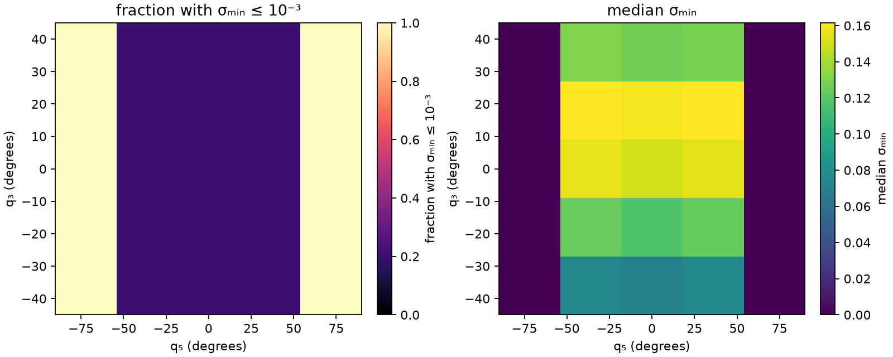

At q=[0,0,0,0,90,0]°: rank(J_scaled, tol=1e−8)=4; σₘᵢₙ=5.987e-18; ||J_scaled v_null||₂=2.989e-16. The stick figure labels all six axes and four fixed offsets.

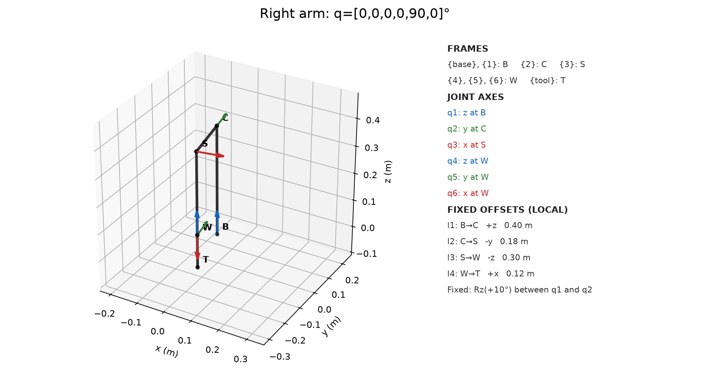

Workspace slice: right arm; y=-0.314345395 m; orientation R=FK([10, 5, -30, -40, -30, 20]°)[:3,:3] (numerical matrix below); x∈[-0.80,0.80] m in 41 steps, z∈[-0.15,0.95] m in 29 steps, 1189 targets. Closed limits as above; IK pose residual ≤1e−8 and duplicate angle tolerance 1e−8 rad. Maximum finite count=2, zero count=1094, continuous=0, unresolved=0. Far upper-right sampled point (0.80,-0.314,0.95) m has count 0.

```text
R =
[[ 0.758671758  0.133403897 -0.637668067]
 [ 0.029148166  0.970878458  0.237792776]
 [ 0.650820673 -0.198993518  0.732689588]]
```

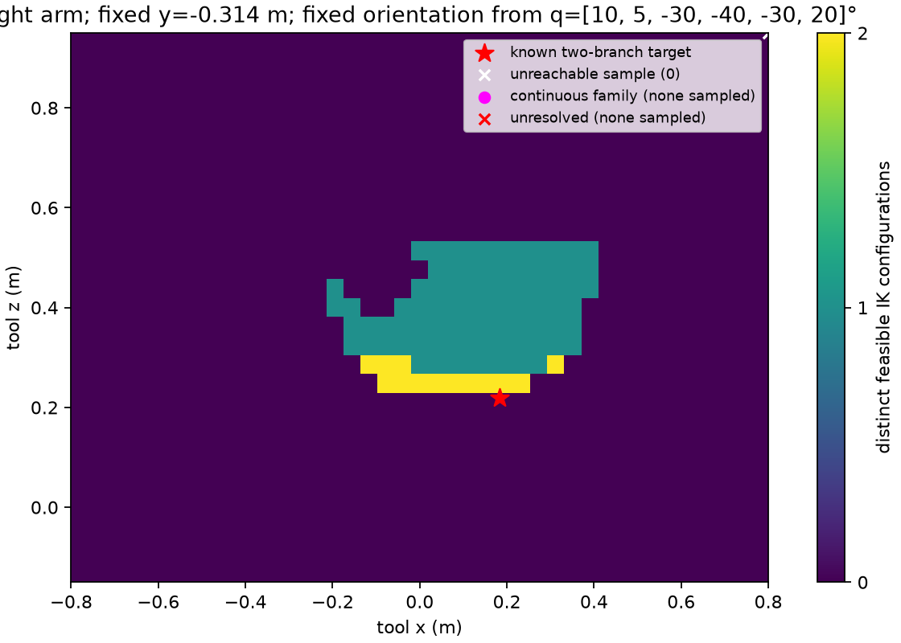

Different joint-space samples may reach the same Cartesian point; a Cartesian plot can therefore overlay branches and is not a one-to-one representation of joint space. Source: `src/task6_singularity.py`; Jacobian verification: `src/task5_jacobian.py`, `tests/test_tasks4_to_6.py`.
